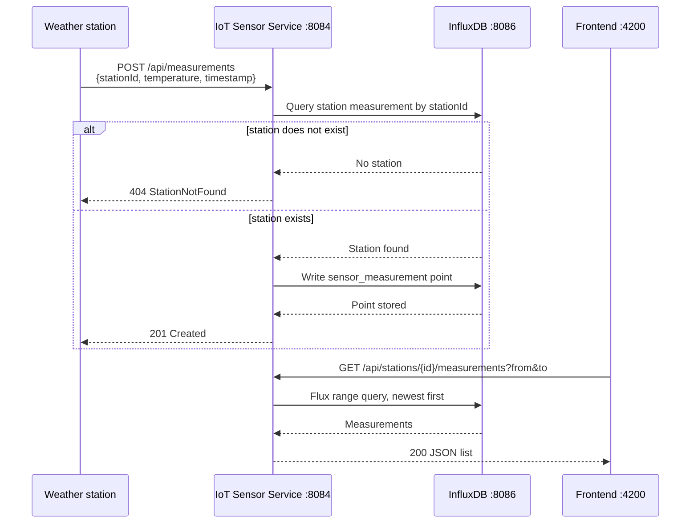

# SkyTrack IoT Sensor Service

Autonomous Spring Boot 3 / Java 21 microservice for weather stations and
write-heavy sensor measurements. It stores both station metadata and
measurements in InfluxDB 2.x and does not call any other microservice.

## Project tree

```text
iot-sensor-service/
├── pom.xml
├── Dockerfile
├── docker-compose.yml
├── README.md
├── src/main/resources/application.yml
├── src/main/java/tn/esprit/skytrack/iotsensor/
│   ├── IoTSensorApplication.java
│   ├── config/                  # Influx, CORS, and health configuration
│   ├── controller/              # Station and measurement REST endpoints
│   ├── dto/                     # Validated request and response records
│   ├── exception/               # Domain exceptions and uniform API errors
│   ├── model/                   # Station and measurement domain records
│   ├── repository/              # Interfaces and InfluxDB implementations
│   └── service/                 # Application rules
└── src/test/java/.../
    ├── controller/              # WebMvcTest coverage for both controllers
    └── service/                 # Mockito service tests
```

## Run locally

Requirements: Java 21, Maven 3.9+, and Docker.

Set a token before starting InfluxDB:

```powershell
$env:INFLUX_TOKEN = "replace-with-a-long-random-token"
docker compose up -d influxdb
mvn spring-boot:run
```

The API listens on `http://localhost:8084`, Swagger UI is at
`http://localhost:8084/swagger-ui.html`, and the health endpoint is at
`http://localhost:8084/actuator/health`.

To run the complete stack:

```powershell
$env:INFLUX_TOKEN = "replace-with-a-long-random-token"
mvn clean package
docker compose up --build
```

## Environment variables

| Variable | Default | Description |
|---|---|---|
| `SERVER_PORT` | `8084` | HTTP port |
| `INFLUX_URL` | `http://localhost:8086` | InfluxDB URL |
| `INFLUX_ORG` | `skytrack` | Influx organization |
| `INFLUX_BUCKET` | `iot_sensor` | Influx bucket |
| `INFLUX_TOKEN` | empty | Required InfluxDB token; never hardcoded |
| `INFLUX_USERNAME` | `admin` | Docker initialization username |
| `INFLUX_PASSWORD` | `skytrack-admin-password` | Docker initialization password |

## API examples

Create a station:

```bash
curl -X POST http://localhost:8084/api/stations \
  -H "Content-Type: application/json" \
  -d '{"id":"ST-001","cityId":1,"name":"Tunis North"}'
```

List/filter stations and read one:

```bash
curl "http://localhost:8084/api/stations?cityId=1"
curl http://localhost:8084/api/stations/ST-001
```

Update station details and delete:

```bash
curl -X PUT http://localhost:8084/api/stations/ST-001 \
  -H "Content-Type: application/json" \
  -d '{"cityId":1,"name":"Tunis North Updated"}'
curl -X DELETE http://localhost:8084/api/stations/ST-001
```

Create one or up to 500 measurements (the station must exist):

```bash
curl -X POST http://localhost:8084/api/measurements \
  -H "Content-Type: application/json" \
  -d '{"stationId":"ST-001","temperature":24.5}'
curl -X POST http://localhost:8084/api/measurements/batch \
  -H "Content-Type: application/json" \
  -d '{"measurements":[{"stationId":"ST-001","temperature":24.5},{"stationId":"ST-001","temperature":24.8}]}'
```

Read measurements, latest values, rolling-window stats, and latest values by
city:

```bash
curl "http://localhost:8084/api/stations/ST-001/measurements?from=2026-01-01T00:00:00Z&to=2026-01-02T00:00:00Z&limit=100"
curl http://localhost:8084/api/stations/ST-001/measurements/latest
curl "http://localhost:8084/api/stations/ST-001/measurements/stats?window=1h"
curl "http://localhost:8084/api/measurements/latest?cityId=1"
```

All time values are ISO-8601 instants. Measurement validation enforces
temperature `-90..60`. Requests with an invalid time range return the uniform
error shape:

```json
{
  "timestamp": "2026-01-01T12:00:00Z",
  "status": 400,
  "error": "Bad Request",
  "message": "The from instant must be before the to instant",
  "path": "/api/stations/ST-001/measurements"
}
```

## Profiles

The `dev` profile seeds three stations and one measurement for each station:

```powershell
mvn spring-boot:run "-Dspring-boot.run.profiles=dev"
```

The `simulator` profile writes a random temperature for every station every
30 seconds:

```powershell
mvn spring-boot:run "-Dspring-boot.run.profiles=simulator"
```

Profiles are opt-in and do not run in the default configuration.

## IoT sequence diagram



The service is autonomous: it never calls Location or User. `cityId` is stored
as an ID only, and Analytics or another service may call this API later.

## API contract

| Endpoint | Method | Success | Client errors |
|---|---:|---|---|
| `/api/stations` | POST | 201 Created | 400, 409 |
| `/api/stations?cityId={cityId}` | GET | 200 OK | 400 |
| `/api/stations/{id}` | GET | 200 OK | 404 |
| `/api/stations/{id}` | PUT | 200 OK | 400, 404 |
| `/api/stations/{id}` | DELETE | 204 No Content | 404 |
| `/api/measurements` | POST | 201 Created | 400, 404 |
| `/api/measurements/batch` | POST | 201 Created | 400, 404 |
| `/api/stations/{id}/measurements` | GET | 200 OK | 400, 404 |
| `/api/stations/{id}/measurements/latest` | GET | 200 OK | 404 |
| `/api/stations/{id}/measurements/stats` | GET | 200 OK | 400, 404 |
| `/api/measurements/latest?cityId={cityId}` | GET | 200 OK | 400 |
