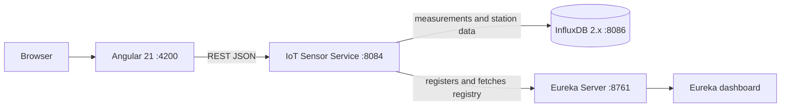

# SkyTrack workspace

This repository currently contains an Angular frontend, the IoT Sensor Spring
Boot service, and a Eureka discovery server. The other services in the original
SkyTrack architecture are not present in this workspace; this README describes
only code that exists here.

> **Assignment material:** `Atelier_Eureka_server_Part1.pdf` was not found in
> the workspace, so the PDF itself could not be inspected.

## Architecture



The IoT service stores station metadata and measurements in InfluxDB. Eureka
provides service discovery; it does not proxy API traffic.

## Services and workspace status

| Project | Present | Technology / versions | Default port | Entry point |
|---|---|---|---:|---|
| Eureka Server | Yes (added here) | Java 17, Spring Boot 4.0.10, Spring Cloud 2025.1.5, Maven JAR | 8761 | `com.example.eurekaserver.EurekaServerApplication` |
| IoT Sensor Service | Yes | Java 21, Spring Boot 3.5.7, Spring Cloud 2025.0.5, Maven JAR | 8084 | `tn.esprit.skytrack.iotsensor.IoTSensorApplication` |
| Frontend | Yes | Angular 21, TypeScript | 4200 | Angular application |
| Candidat | No | Not available to inspect | — | — |
| Job | No | Not available to inspect | — | — |
| Meeting | No | Not available to inspect | — | — |
| Notification | No | Not available to inspect | — | — |

No Candidat, Job, Meeting, or Notification project, endpoint, dependency
manifest, or runtime behavior was found. No hello endpoint is claimed for those
services. The requested Candidat/Job two-instance commands and Meeting and
Notification integration cannot be supplied until those projects are provided.

The IoT service did not previously have Spring Cloud dependencies. Spring
Cloud 2025.1.x aligns with Spring Boot 4.0.x, while Spring Cloud 2025.0.x
aligns with Spring Boot 3.5.x. The new Eureka server uses the requested
Boot 4.0.10 / Cloud 2025.1.5 combination. IoT remains on its existing Boot
3.5.7 / Java 21 versions and uses Cloud 2025.0.5 for its Eureka client; it was
not upgraded to an incompatible release train.

## Project structure

```text
Backend/
├── eureka-server/                 # Spring Cloud Netflix Eureka Server
└── iot-sensor-service/             # Spring Boot API, InfluxDB, Docker Compose
Frontend/                            # Angular 21 client for the IoT API
Documentation/                       # Existing project documentation
README.md
```

## Prerequisites

- JDK 17 for Eureka and JDK 21 for the IoT service
- Maven 3.9+
- Docker Desktop with Docker Compose (for InfluxDB and the composed backend)
- Node.js and npm (for the Angular frontend)

## Build and run

Run each command in its own PowerShell terminal. Maven downloads declared
dependencies on the first build.

### Eureka Server

```powershell
cd Backend\eureka-server
mvn clean package
java -jar target\eureka-server-0.0.1-SNAPSHOT.jar
```

The dashboard is at <http://localhost:8761>. The port can be overridden with
standard Spring Boot configuration, for example:

```powershell
java -jar target\eureka-server-0.0.1-SNAPSHOT.jar --server.port=8762
```

### IoT Sensor Service

For local development, start Eureka first, then start InfluxDB and the service.
Set a non-empty InfluxDB token for the local Compose database:

```powershell
cd Backend\iot-sensor-service
$env:INFLUX_TOKEN = "replace-with-a-long-random-token"
docker compose up -d influxdb
mvn clean package
mvn spring-boot:run
```

The API listens on <http://localhost:8084/api>; the existing frontend uses this
base URL. Existing API examples and routes are documented in
[Backend/iot-sensor-service/README.md](Backend/iot-sensor-service/README.md).
The service also exposes Swagger UI at
<http://localhost:8084/swagger-ui.html> and health at
<http://localhost:8084/actuator/health>. No `/api/.../hello` route exists in
this service.

Configuration:

| Setting | Default | Purpose |
|---|---|---|
| `SERVER_PORT` | `8084` | IoT HTTP port |
| `EUREKA_CLIENT_SERVICE_URL_DEFAULT_ZONE` | `http://localhost:8761/eureka/` | Eureka registry URL |
| `INFLUX_URL` | `http://localhost:8086` | InfluxDB URL |
| `INFLUX_ORG` | `skytrack` | InfluxDB organization |
| `INFLUX_BUCKET` | `iot_sensor` | InfluxDB bucket |
| `INFLUX_TOKEN` | empty | InfluxDB access token |

To run a second IoT instance, use another terminal and port; both instances
register independently as `iot-sensor-service`:

```powershell
cd Backend\iot-sensor-service
$env:SERVER_PORT = "8085"
$env:EUREKA_CLIENT_SERVICE_URL_DEFAULT_ZONE = "http://localhost:8761/eureka/"
mvn spring-boot:run
```

For a containerized backend, package both JARs first, then launch the Eureka
server, IoT service, and InfluxDB together:

```powershell
cd Backend\eureka-server
mvn clean package
cd ..\iot-sensor-service
mvn clean package
$env:INFLUX_TOKEN = "replace-with-a-long-random-token"
docker compose up --build
```

Compose gives the IoT container the internal registry address
`http://eureka-server:8761/eureka/`; the host dashboard remains at
<http://localhost:8761>.

### Angular frontend

```powershell
cd Frontend
npm install
npm start
```

The development server is <http://localhost:4200>. Its current environment
points to the IoT API at `http://localhost:8084/api`.

## Eureka registration

- Dashboard: <http://localhost:8761>
- Eureka REST registry: <http://localhost:8761/eureka/apps>
- Existing registered application: `iot-sensor-service` (port 8084 by default;
  another instance can use 8085)
- Eureka server itself does not register with or fetch from its own registry.

## Troubleshooting

- **Maven or Java not found:** install Maven 3.9+ and the JDK version required
  for the specific project, then check `mvn -version` and `java -version`.
- **No service appears in Eureka:** start Eureka first, confirm the configured
  URL is reachable, and allow the client time to register. In Compose, use the
  service hostname `eureka-server`, not `localhost`.
- **IoT service fails to connect to InfluxDB:** make sure InfluxDB is running
  and `INFLUX_TOKEN`, organization, bucket, and URL match its initialization.
- **Port already in use:** set `SERVER_PORT` for the IoT service or pass
  `--server.port=<port>` to the Eureka JAR. Ensure the selected port is free.
- **Frontend cannot reach the API:** start IoT on port 8084 or update the
  frontend environment URL to match the chosen port.

## Verification checklist

- [ ] `mvn clean package` succeeds in `Backend\eureka-server`.
- [ ] `mvn clean package` succeeds in `Backend\iot-sensor-service`.
- [ ] Eureka dashboard opens at <http://localhost:8761>.
- [ ] `iot-sensor-service` appears in the Eureka application registry.
- [ ] IoT API health responds at <http://localhost:8084/actuator/health>.
- [ ] A second IoT instance can run on port 8085 and register separately.
- [ ] Angular opens at <http://localhost:4200> and can reach the IoT API.

## Dashboard screenshot

<!-- TODO: Add a screenshot of the running Eureka dashboard and registered applications. -->

## Team member

- yassinewesslati
